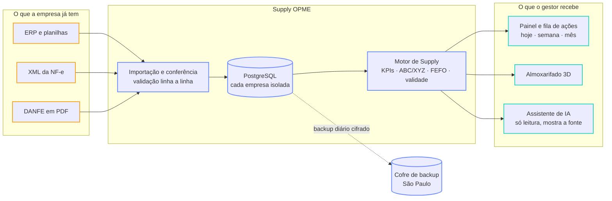

<!-- As imagens de assets/ e a lista de certificados são geradas por scripts/gerar_perfil.py.
     Para mudar textos, números ou certificados, edite dados/perfil.json ou dados/certificados.csv. -->

<picture>
  <source media="(prefers-color-scheme: dark)" srcset="assets/banner-escuro.svg">
  
</picture>

 

## Sobre mim

Sou o Gabriel, de Olinda (PE). Trabalho com Supply Chain & Operations e estou terminando Administração na FCAP/UPE. Antes disso passei por compras num hospital universitário, controladoria na Benteler e almoxarifado na Musashi, e nos três lugares vi a mesma cena: dinheiro parado na prateleira, item faltando na hora errada e decisão de compra tomada no olho, porque ninguém tinha tempo de sentar com os números.

Foi isso que me levou a estudar dados a sério. Já são <!--HORAS-->999<!--/HORAS--> horas de curso entre BI, SQL, Python, estatística e engenharia de dados, e hoje meu foco é juntar as duas pontas: pegar o que a empresa já tem no ERP e nas planilhas e transformar em resposta para o que comprar, quanto e quando.

## Supply OPME

É o projeto em que estou trabalhando. A ideia é ser o departamento de Supply Chain de distribuidoras e importadoras de OPME (órteses, próteses e materiais especiais) que não têm um planejador dedicado, sem virar mais um ERP. O sistema recebe o que a empresa já exporta, como planilhas, XML de NF-e e DANFE em PDF, confere tudo linha a linha e devolve indicadores, alertas de validade e uma fila de ações para hoje, para a semana e para o mês.

O código é privado, mas dá para mostrar o que já está de pé:

<picture>
  <source media="(prefers-color-scheme: dark)" srcset="assets/projeto-escuro.svg">
  
</picture>

<b>Como funciona por dentro</b> (clique para abrir o diagrama)

 

O saldo nunca é digitado: ele sai das movimentações, que não podem ser apagadas, só estornadas. Cada empresa enxerga apenas os próprios dados por regra no banco, e não entra dado de paciente em lugar nenhum.

<picture>
  <source media="(prefers-color-scheme: dark)" srcset="assets/roadmap-escuro.svg">
  
</picture>

## Ferramentas

<picture>
  <source media="(prefers-color-scheme: dark)" srcset="assets/stack-escuro.svg">
  
</picture>

## Certificados

<picture>
  <source media="(prefers-color-scheme: dark)" srcset="assets/certificados-escuro.svg">
  
</picture>

<!-- CERTIFICADOS:INICIO -->
**Alura** · 97 cursos · 931 h · [certificado completo ↗](https://cursos.alura.com.br/user/gabel113rocha/fullCertificate/1f3b8be78d09e41a1f482427f673326d)

<b>Iniciando com Engenharia de Dados</b> · 9 cursos · 82 h · ago/2023

| Curso | Área | Horas | Concluído |
|---|---|--:|--:|
| Python: começando com a linguagem | Python & data science | 12 | 08/04/2023 |
| Apache Airflow: orquestrando seu primeiro pipeline de dados | Engenharia de dados | 8 | 02/08/2023 |
| Python: avançando na linguagem | Python & data science | 12 | 04/08/2023 |
| Apache Beam: data pipeline com Python | Engenharia de dados | 12 | 05/08/2023 |
| PostgreSQL | Bancos de dados & SQL | 8 | 08/08/2023 |
| PostgreSQL: views, subconsultas e funções | Bancos de dados & SQL | 6 | 08/08/2023 |
| Engenharia de dados: organizando dados na AWS | Engenharia de dados | 8 | 08/08/2023 |
| Linux Onboarding: usando a CLI de uma forma rápida e prática | Engenharia de dados | 8 | 09/08/2023 |
| Linux Onboarding: localizando arquivos e conteúdos | Engenharia de dados | 8 | 09/08/2023 |

<b>Engenharia de dados com Databricks</b> · 6 cursos · 54 h · ago/2023

| Curso | Área | Horas | Concluído |
|---|---|--:|--:|
| Databricks: conhecendo a ferramenta | Engenharia de dados | 8 | 03/08/2023 |
| Databricks: trabalhando com diversos formatos e tipos de arquivos | Engenharia de dados | 8 | 03/08/2023 |
| Databricks: análise de dados | Engenharia de dados | 8 | 04/08/2023 |
| Databricks: criando um sistema de recomendação | Engenharia de dados | 10 | 04/08/2023 |
| Databricks e Data Factory: criando e orquestrando pipelines na nuvem | Engenharia de dados | 10 | 04/08/2023 |
| Databricks: construindo pipelines de dados com Airflow e Azure Databricks | Engenharia de dados | 10 | 04/08/2023 |

<b>Apache Airflow</b> · 5 cursos · 44 h · ago/2023

| Curso | Área | Horas | Concluído |
|---|---|--:|--:|
| Apache Airflow: orquestrando seu primeiro pipeline de dados | Engenharia de dados | 8 | 02/08/2023 |
| Apache Airflow: extração de dados | Engenharia de dados | 10 | 02/08/2023 |
| Apache Airflow: transformação de dados com Spark | Engenharia de dados | 10 | 02/08/2023 |
| Aprofundando no Airflow: executores Local e Celery | Engenharia de dados | 8 | 03/08/2023 |
| Aprofundando no Airflow: executor Kubernetes | Engenharia de dados | 8 | 03/08/2023 |

<b>BI e Data Warehouse com Pentaho</b> · 7 cursos · 102 h · ago/2023

| Curso | Área | Horas | Concluído |
|---|---|--:|--:|
| Business Intelligence: trabalhando com Data Warehouse | BI & visualização | 12 | 28/04/2023 |
| Modelos de ETL: Pentaho Data Integration | Engenharia de dados | 14 | 26/06/2023 |
| Transformação com ETL: Pentaho Data Integration | Engenharia de dados | 16 | 28/06/2023 |
| OLAP com Pentaho: construção do Data Mart | BI & visualização | 16 | 28/06/2023 |
| Consultas multidimensionais: MDX com Pentaho | BI & visualização | 14 | 02/08/2023 |
| Report Analysis com Pentaho: gerando relatórios empresariais | BI & visualização | 16 | 02/08/2023 |
| Dashboard com Pentaho: visualize e analise os dados | BI & visualização | 14 | 02/08/2023 |

<b>SQL com MySQL Server da Oracle</b> · 5 cursos · 66 h · jun/2023

| Curso | Área | Horas | Concluído |
|---|---|--:|--:|
| SQL com MySQL: manipule e consulte dados | Bancos de dados & SQL | 12 | 09/06/2023 |
| Consultas SQL: avançando no SQL com MySQL | Bancos de dados & SQL | 14 | 26/06/2023 |
| Comandos DML: manipulação de dados com MySQL | Bancos de dados & SQL | 10 | 26/06/2023 |
| Procedures SQL: executando código no MySQL | Bancos de dados & SQL | 14 | 26/06/2023 |
| Administração do MySQL: segurança e otimização do banco | Bancos de dados & SQL | 16 | 26/06/2023 |

<b>Administração e performance com Oracle Database</b> · 4 cursos · 50 h · mai/2023

| Curso | Área | Horas | Concluído |
|---|---|--:|--:|
| Administração do Oracle Database: criação e gerenciamento do banco | Bancos de dados & SQL | 10 | 20/05/2023 |
| Administração do Oracle Database: segurança e otimização do banco | Bancos de dados & SQL | 14 | 20/05/2023 |
| Desempenho do Oracle Database: análise do ambiente | Bancos de dados & SQL | 12 | 20/05/2023 |
| Desempenho do Oracle Database: otimização de consultas | Bancos de dados & SQL | 14 | 20/05/2023 |

<b>Data Mesh</b> · 4 cursos · 30 h · mai/2023

| Curso | Área | Horas | Concluído |
|---|---|--:|--:|
| Data Mesh: uma abordagem distribuída para dados | Engenharia de dados | 8 | 05/05/2023 |
| Data Mesh: dados como produtos | Engenharia de dados | 10 | 05/05/2023 |
| Data Mesh: controle e dependências | Engenharia de dados | 6 | 05/05/2023 |
| Data Mesh: infraestrutura e planos | Engenharia de dados | 6 | 05/05/2023 |

<b>Power BI</b> · 5 cursos · 42 h · mai/2023

| Curso | Área | Horas | Concluído |
|---|---|--:|--:|
| Power BI Desktop: construindo meu primeiro dashboard | BI & visualização | 8 | 24/03/2023 |
| Dashboard com Power BI: visualizando dados | BI & visualização | 8 | 27/04/2023 |
| Power BI Desktop: tratamento de dados no Power Query | BI & visualização | 8 | 27/04/2023 |
| Power BI: entendendo as fórmulas DAX | BI & visualização | 10 | 27/04/2023 |
| Power BI: explorando recursos visuais | BI & visualização | 8 | 04/05/2023 |

<b>BI e Data Warehouse com SQL Server e Power BI</b> · 6 cursos · 60 h · abr/2023

| Curso | Área | Horas | Concluído |
|---|---|--:|--:|
| Business Intelligence: trabalhando com Data Warehouse | BI & visualização | 12 | 28/04/2023 |
| ETL com Integration Services: modelo de dados | Engenharia de dados | 6 | 28/04/2023 |
| ETL com Integration Services: transformação de dados | Engenharia de dados | 10 | 28/04/2023 |
| OLAP com SQL Server: construção do Data Warehouse | BI & visualização | 10 | 28/04/2023 |
| Consultas multidimensionais: MDX com SQL Server | BI & visualização | 10 | 28/04/2023 |
| Report Analysis com Power BI: gerando relatórios empresariais | BI & visualização | 12 | 28/04/2023 |

<b>Estatística com R</b> · 5 cursos · 56 h · abr/2023

| Curso | Área | Horas | Concluído |
|---|---|--:|--:|
| Estatística com R: frequências e medidas | Estatística & forecast | 12 | 27/04/2023 |
| Estatística com R: probabilidade e amostragem | Estatística & forecast | 12 | 27/04/2023 |
| Estatística com R: testes de hipóteses | Estatística & forecast | 12 | 27/04/2023 |
| Estatística com R: correlação e regressão | Estatística & forecast | 12 | 27/04/2023 |
| Estatística com R: crie e compare modelos estatísticos | Estatística & forecast | 8 | 28/04/2023 |

<b>Data Science</b> · 12 cursos · 96 h · abr/2023

| Curso | Área | Horas | Concluído |
|---|---|--:|--:|
| Python Pandas: tratando e analisando dados | Python & data science | 12 | 16/01/2023 |
| Data Visualization: técnicas de visualização com Google Sheets | BI & visualização | 8 | 27/03/2023 |
| Estatística com Python: frequências e medidas | Estatística & forecast | 10 | 03/04/2023 |
| Estatística com Python: probabilidade e amostragem | Estatística & forecast | 10 | 03/04/2023 |
| Data Science: análise e visualização de dados | Python & data science | 6 | 03/04/2023 |
| Data Science: testes estatísticos com Python | Estatística & forecast | 6 | 04/04/2023 |
| Regressão linear: testando relações e prevendo resultados | Estatística & forecast | 12 | 04/04/2023 |
| Regressão linear: técnicas avançadas de modelagem | Estatística & forecast | 5 | 04/04/2023 |
| Análise de experimentos: testes, mapas de cores e análises dos dados | Estatística & forecast | 6 | 04/04/2023 |
| Data Visualization: criação de gráficos com o Matplotlib | Python & data science | 6 | 04/04/2023 |
| Data Science: análises para saúde e medicina | Python & data science | 8 | 04/04/2023 |
| Data Science: visualização de dados para saúde e medicina | Python & data science | 7 | 04/04/2023 |

<b>Estatística com Python</b> · 8 cursos · 69 h · abr/2023

| Curso | Área | Horas | Concluído |
|---|---|--:|--:|
| Estatística com Python: frequências e medidas | Estatística & forecast | 10 | 03/04/2023 |
| Estatística com Python: probabilidade e amostragem | Estatística & forecast | 10 | 03/04/2023 |
| Estatística com Python: testes de hipóteses | Estatística & forecast | 10 | 04/04/2023 |
| Data Science: testes estatísticos com Python | Estatística & forecast | 6 | 04/04/2023 |
| Estatística com Python: correlação e regressão | Estatística & forecast | 10 | 04/04/2023 |
| Regressão linear: testando relações e prevendo resultados | Estatística & forecast | 12 | 04/04/2023 |
| Regressão linear: técnicas avançadas de modelagem | Estatística & forecast | 5 | 04/04/2023 |
| Análise de experimentos: testes, mapas de cores e análises dos dados | Estatística & forecast | 6 | 04/04/2023 |

<b>Python para Data Science</b> · 7 cursos · 66 h · abr/2023

| Curso | Área | Horas | Concluído |
|---|---|--:|--:|
| Python para Data Science | Python & data science | 10 | 16/08/2022 |
| Python para Data Science: linguagem e Numpy | Python & data science | 12 | 16/09/2022 |
| Python para Data Science: funções, pacotes e Pandas | Python & data science | 10 | 29/09/2022 |
| Python Pandas: tratando e analisando dados | Python & data science | 12 | 16/01/2023 |
| Data Visualization: explorando com Seaborn | Python & data science | 6 | 31/03/2023 |
| Data Science: análise de séries temporais | Estatística & forecast | 6 | 31/03/2023 |
| Corretor ortográfico em Python: aplicando técnicas de NLP | Python & data science | 10 | 01/04/2023 |

<b>VBA</b> · 6 cursos · 56 h · mar/2023

| Curso | Área | Horas | Concluído |
|---|---|--:|--:|
| Excel: criação de macros e automatização de tarefas | Excel & VBA | 12 | 28/03/2023 |
| Excel: personalizando e automatizando tarefas com VBA | Excel & VBA | 8 | 28/03/2023 |
| Excel VBA: automatize tarefas diárias mesmo não sendo programador | Excel & VBA | 8 | 28/03/2023 |
| Excel VBA: criando formulários para facilitar a entrada de dados nas planilhas | Excel & VBA | 8 | 29/03/2023 |
| Excel VBA 3: criando conexão com o Outlook Application | Excel & VBA | 10 | 29/03/2023 |
| Excel VBA 4: criando conexão com Access | Excel & VBA | 10 | 29/03/2023 |

<b>Excel VBA</b> · 8 cursos · 74 h · mar/2023

| Curso | Área | Horas | Concluído |
|---|---|--:|--:|
| Excel: domine o editor de planilhas | Excel & VBA | 10 | 17/01/2023 |
| Funções com Excel: operações matemáticas e filtros | Excel & VBA | 10 | 18/01/2023 |
| Excel PROCV: lógica booleana e busca por valores | Excel & VBA | 12 | 19/01/2023 |
| Excel: tabelas dinâmicas e dashboards | Excel & VBA | 10 | 20/01/2023 |
| Excel: simulação e análise de cenários | Excel & VBA | 6 | 20/01/2023 |
| Análise de dados: cálculos, padrões e estratégias com Excel | Excel & VBA | 6 | 20/01/2023 |
| Excel: criação de macros e automatização de tarefas | Excel & VBA | 12 | 28/03/2023 |
| Excel: personalizando e automatizando tarefas com VBA | Excel & VBA | 8 | 28/03/2023 |

<b>Data Analysis com Google Sheets</b> · 4 cursos · 30 h · mar/2023

| Curso | Área | Horas | Concluído |
|---|---|--:|--:|
| Data Analysis: Google Sheets | BI & visualização | 6 | 27/03/2023 |
| Data Analysis: previsões com Google Sheets | Estatística & forecast | 8 | 27/03/2023 |
| Data Analysis: estatística com Google Sheets | Estatística & forecast | 8 | 27/03/2023 |
| Data Visualization: técnicas de visualização com Google Sheets | BI & visualização | 8 | 27/03/2023 |

<b>Excel</b> · 6 cursos · 54 h · jan/2023

| Curso | Área | Horas | Concluído |
|---|---|--:|--:|
| Excel: domine o editor de planilhas | Excel & VBA | 10 | 17/01/2023 |
| Funções com Excel: operações matemáticas e filtros | Excel & VBA | 10 | 18/01/2023 |
| Excel PROCV: lógica booleana e busca por valores | Excel & VBA | 12 | 19/01/2023 |
| Excel: tabelas dinâmicas e dashboards | Excel & VBA | 10 | 20/01/2023 |
| Excel: simulação e análise de cenários | Excel & VBA | 6 | 20/01/2023 |
| Análise de dados: cálculos, padrões e estratégias com Excel | Excel & VBA | 6 | 20/01/2023 |

<b>Cursos avulsos · Gestão &amp; agilidade</b> · 4 cursos · 30 h · jul/2023

| Curso | Área | Horas | Concluído |
|---|---|--:|--:|
| Agilidade: promovendo a transformação ágil | Gestão & agilidade | 6 | 14/06/2023 |
| A Empresa Ágil: implemente o Business Agility nas organizações | Gestão & agilidade | 6 | 15/06/2023 |
| Scrum: agilidade em seu projeto | Gestão & agilidade | 10 | 12/07/2023 |
| Ferramentas para agilidade: visão geral sobre controle de projetos e produtos | Gestão & agilidade | 8 | 15/07/2023 |

<b>Cursos avulsos · BI &amp; visualização</b> · 3 cursos · 23 h · jun/2023

| Curso | Área | Horas | Concluído |
|---|---|--:|--:|
| BI com Excel: crie bancos de dados com planilhas | BI & visualização | 10 | 25/03/2023 |
| BI com Excel: criando um dashboard sem complicação | BI & visualização | 8 | 25/03/2023 |
| Data Visualization parte 1: gráficos com uma variável | BI & visualização | 5 | 09/06/2023 |

<b>Cursos avulsos · Engenharia de dados</b> · 1 curso · 10 h · ago/2023

| Curso | Área | Horas | Concluído |
|---|---|--:|--:|
| Spark: apresentando a ferramenta | Engenharia de dados | 10 | 09/08/2023 |

**EY** · 40 cursos

<b>Supply chain &amp; operações</b> · 15 cursos · out/2026

| Curso | Área | Horas | Concluído |
|---|---|--:|--:|
| Supply Chain Operations Transformation | Supply chain & operações | — | 31/08/2026 |
| Supply Chain Overview | Supply chain & operações | — | 16/09/2026 |
| Introduction to Logistics: Digital Fulfilment | Supply chain & operações | — | 18/09/2026 |
| Supply Chain Cost Reduction Focus Areas | Supply chain & operações | — | 18/09/2026 |
| Supply Chain Resiliency | Supply chain & operações | — | 21/09/2026 |
| Supply Chain Trends and SCOR Model Deeper Dive | Supply chain & operações | — | 21/09/2026 |
| Supply Chain Performance Management and Analytics | Supply chain & operações | — | 22/09/2026 |
| Understanding the Manufacturing Environment | Supply chain & operações | — | 05/10/2026 |
| Introduction to Logistics: Warehouse Design, Processes and KPIs | Supply chain & operações | — | 05/10/2026 |
| Introduction to Enterprise Asset Management (EAM) | Supply chain & operações | — | 05/10/2026 |
| Sales and Operations Planning | Supply chain & operações | — | 05/10/2026 |
| Introduction to Logistics: Network Design | Supply chain & operações | — | 06/10/2026 |
| Introduction to Circular Economy | Supply chain & operações | — | 09/10/2026 |
| Supply Chain Value Chain Tradeoffs | Supply chain & operações | — | 09/10/2026 |
| Supply Chain Cost Reduction Overview | Supply chain & operações | — | 09/10/2026 |

<b>Gestão &amp; agilidade</b> · 7 cursos · set/2026

| Curso | Área | Horas | Concluído |
|---|---|--:|--:|
| Design Thinking | Gestão & agilidade | — | 27/08/2026 |
| Introduction to Change Management | Gestão & agilidade | — | 27/08/2026 |
| Introduction to All in Transformation | Gestão & agilidade | — | 14/09/2026 |
| Introduction to Inclusive Leadership for All | Gestão & agilidade | — | 15/09/2026 |
| Inclusive Leadership for All – Course 1: The Value of Difference | Gestão & agilidade | — | 15/09/2026 |
| Inclusive Leadership for All – Course 2: Lead and Team with Agility | Gestão & agilidade | — | 15/09/2026 |
| Inclusive Leadership for All – Course 3: Building a Sense of Belonging for All | Gestão & agilidade | — | 15/09/2026 |

<b>BI &amp; visualização</b> · 6 cursos · out/2026

| Curso | Área | Horas | Concluído |
|---|---|--:|--:|
| Creating Data Visualizations | BI & visualização | — | 27/08/2026 |
| Core Data Analytics with Microsoft Power BI: Cleansing | BI & visualização | — | 23/10/2026 |
| Core Data Analytics with Microsoft Power BI: Ingesting | BI & visualização | — | 23/10/2026 |
| Core Data Analytics with Microsoft Power BI: Interpreting | BI & visualização | — | 23/10/2026 |
| Core Data Analytics with Microsoft Power BI: Merging and Appending | BI & visualização | — | 23/10/2026 |
| Core Data Analytics with Microsoft Power BI: Reporting | BI & visualização | — | 23/10/2026 |

<b>Excel &amp; VBA</b> · 6 cursos · out/2026

| Curso | Área | Horas | Concluído |
|---|---|--:|--:|
| Core Data Analytics with Microsoft Excel: Cleansing | Excel & VBA | — | 06/10/2026 |
| Core Data Analytics with Microsoft Excel: Interpreting | Excel & VBA | — | 07/10/2026 |
| Core Data Analytics with Microsoft Excel: Reporting | Excel & VBA | — | 16/10/2026 |
| Core Data Analytics with Microsoft Excel: Ingesting | Excel & VBA | — | 22/10/2026 |
| Core Data Analytics with Microsoft Excel: Validating and Transforming | Excel & VBA | — | 22/10/2026 |
| Core Data Analytics with Microsoft Excel: Merging and Appending | Excel & VBA | — | 22/10/2026 |

<b>IA aplicada</b> · 5 cursos · set/2026

| Curso | Área | Horas | Concluído |
|---|---|--:|--:|
| AI Now 2.0: Use GenAI as your Thought Partner (módulo 1) | IA aplicada | — | 28/08/2026 |
| AI Now 2.0: Use GenAI as your Thought Partner (módulo 2) | IA aplicada | — | 28/08/2026 |
| AI Now 3.0: Agents of Change | IA aplicada | — | 31/08/2026 |
| AI Skills for Consulting: EY.ai Value Blueprints | IA aplicada | — | 31/08/2026 |
| Copilot Flight School | IA aplicada | — | 01/09/2026 |

<b>Qualidade &amp; Lean</b> · 1 curso · out/2026

| Curso | Área | Horas | Concluído |
|---|---|--:|--:|
| Introduction to Lean | Qualidade & Lean | — | 05/10/2026 |

**DIO** · 19 cursos · 28 h

<b>Bootcamp DIO · Python e dados</b> · 19 cursos · 28 h · fev/2024

| Curso | Área | Horas | Concluído |
|---|---|--:|--:|
| Seja Protagonista Neste Bootcamp | Programação & Git | 1 | 08/01/2024 |
| Fundamentos de Lógica de Programação | Programação & Git | 1 | 09/01/2024 |
| Versionamento de Código com Git e GitHub | Programação & Git | 2 | 12/01/2024 |
| Como Entregar seu Desafio de Projeto | Programação & Git | 1 | 13/01/2024 |
| Ambiente de Desenvolvimento e Primeiros Passos com Python | Python & data science | 1 | 15/01/2024 |
| Conhecendo a Linguagem de Programação Python | Python & data science | 2 | 16/01/2024 |
| Tipos de Operadores com Python | Python & data science | 2 | 17/01/2024 |
| Estruturas Condicionais e de Repetição em Python | Python & data science | 2 | 29/01/2024 |
| Fundamentos de Business Intelligence (BI) | BI & visualização | 2 | 29/01/2024 |
| Contribuindo em um Projeto Open Source no GitHub (projeto) | Programação & Git | 1 | 31/01/2024 |
| Manipulando Strings com Python | Python & data science | 2 | 01/02/2024 |
| Criando um Sistema Bancário com Python (projeto) | Python & data science | 1 | 01/02/2024 |
| Trabalhando com Listas em Python | Python & data science | 1 | 02/02/2024 |
| Conhecendo Tuplas em Python | Python & data science | 1 | 02/02/2024 |
| Aprendendo a Utilizar Dicionários em Python | Python & data science | 1 | 02/02/2024 |
| Explorando Conjuntos em Python | Python & data science | 1 | 02/02/2024 |
| Otimizando o Sistema Bancário com Funções Python (projeto) | Python & data science | 1 | 08/02/2024 |
| Introdução a Banco de Dados | Bancos de dados & SQL | 3 | 25/02/2024 |
| Sistemas de Gerenciamento de Banco de Dados | Bancos de dados & SQL | 2 | 27/02/2024 |

**Udemy** · 7 cursos · 40 h

<b>IA aplicada</b> · 3 cursos · 7 h · set/2026

| Curso | Área | Horas | Concluído | Link |
|---|---|--:|--:|:-:|
| Intro to Copilot in Excel | IA aplicada | 1,5 | 31/08/2026 | [↗](https://www.udemy.com/certificate/UC-c7483ecd-31ca-4baa-ac73-742afcce4093/) |
| Microsoft Copilot for Operations | IA aplicada | 3,5 | 01/09/2026 | [↗](https://www.udemy.com/certificate/UC-f7c4d313-ca61-4bcc-b718-c6240a84f49b/) |
| Microsoft Copilot for Excel: AI-Powered Data Analysis | IA aplicada | 2 | 02/09/2026 | [↗](https://www.udemy.com/certificate/UC-475be388-157d-440b-9003-f93f57d4a3ac/) |

<b>Gestão &amp; agilidade</b> · 2 cursos · 3,5 h · set/2026

| Curso | Área | Horas | Concluído | Link |
|---|---|--:|--:|:-:|
| Project Management Essentials: what every PM needs to know | Gestão & agilidade | 2 | 29/08/2026 | [↗](https://www.udemy.com/certificate/UC-fb47ab93-f7d8-42be-a37f-117415b977d4/) |
| Introduction to Business Process Modeling | Gestão & agilidade | 1,5 | 18/09/2026 | [↗](https://www.udemy.com/certificate/UC-db8b2640-fb4a-4d14-a8cb-e2f5bf81c017/) |

<b>Engenharia de dados</b> · 1 curso · 1 h · ago/2026

| Curso | Área | Horas | Concluído | Link |
|---|---|--:|--:|:-:|
| Introduction to Cloud Computing | Engenharia de dados | 1 | 28/08/2026 | [↗](https://www.udemy.com/certificate/UC-6b246240-02bf-4d70-b4f4-307e548abfb1/) |

<b>Supply chain &amp; operações</b> · 1 curso · 28,5 h · fev/2026

| Curso | Área | Horas | Concluído | Link |
|---|---|--:|--:|:-:|
| Analista de Logística | Supply chain & operações | 28,5 | 11/02/2026 | [↗](https://www.udemy.com/certificate/UC-f7261190-96ff-446b-8865-3111e6cb19e2/) |

**FM2S** · 4 cursos

<b>Qualidade &amp; Lean</b> · 3 cursos

| Curso | Área | Horas | Concluído | Link |
|---|---|--:|--:|:-:|
| Auditor Interno ISO 9001:2015 | Qualidade & Lean | — | — | [↗](https://ead.fm2s.com.br/verify/dcebb38b8a04f32fa925309c299b08a395e20f48) |
| Certificação Lean Seis Sigma White Belt | Qualidade & Lean | — | — | [↗](https://ead.fm2s.com.br/verify/257759616078eda4fb9f31a914e8177c387ccdce) |
| Certificação Lean Seis Sigma Yellow Belt | Qualidade & Lean | — | — | [↗](https://ead.fm2s.com.br/verify/a791b88efe4efcaaabb3409443ca5ecfb10a688d) |

<b>Supply chain &amp; operações</b> · 1 curso

| Curso | Área | Horas | Concluído | Link |
|---|---|--:|--:|:-:|
| Fundamentos da Gestão Logística | Supply chain & operações | — | — | [↗](https://ead.fm2s.com.br/verify/295e3d4651bbedf4fe946aecc40779550107162e) |

<!-- CERTIFICADOS:FIM -->

## Atividade

<picture>
  <source media="(prefers-color-scheme: dark)" srcset="assets/cobrinha-escuro.svg">
  
</picture>

Este perfil se atualiza sozinho todo dia: um script em Python refaz os gráficos, a contagem regressiva e a lista de certificados, e o GitHub Actions publica. A cobrinha vem do <a href="https://github.com/Platane/snk">Platane/snk</a>.
